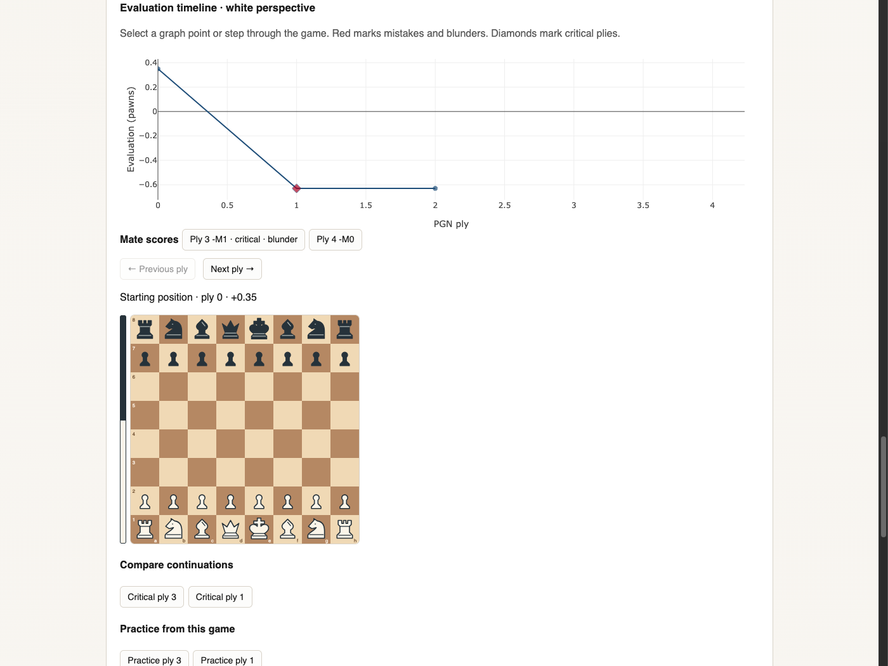

[← Portfolio](/)

# Check Yourself

**Check yourself before your rating wrecks itself.**

Review a completed chess game, replay the turning points, and practice the positions that mattered. Check Yourself runs Stockfish locally and produces interactive reports you can open offline.

- [Explore a single game](single.html) with a clickable evaluation timeline and suggested continuations.
- [Explore multiple games](multi.html) with batch summaries, recurring patterns, and playable exercises.

Both reports use synthetic games.

## Engineering

The typed Python API replays local PGN and ties every evaluation to an exact ply and board position. It manages the Stockfish process, preserves mate distances separately from centipawn scores, and emits versioned JSON. The optional HTML renderer keeps played and hypothetical continuations distinct. Exercises score the saved recommendation and other verified solutions, with ungraded alternatives labeled as such.

## Try it

Install Python 3.11–3.14 and put the separately installed Stockfish executable on your path.

```sh
python -m pip install 'check-yourself-chess[html]==0.2.0'
check-yourself analyze-pgn game.pgn --color white -o analysis.json --html review.html
check-yourself analyze-pgn batch.pgn --player Alice -o batch.json --html batch.html
```

The [release checks](https://github.com/baddatatude/check-yourself/pull/1/checks) passed on macOS 15 and Ubuntu 24.04 with Python 3.11–3.14. They covered offline analysis, real Stockfish runs, fresh wheel installs, and Chrome interactions. The supported local workflow needs no account or API key.

[GitHub source and Python examples](https://github.com/baddatatude/check-yourself) · [PyPI package](https://pypi.org/project/check-yourself-chess/0.2.0/) · [Demo licensing and attribution](licenses/)


